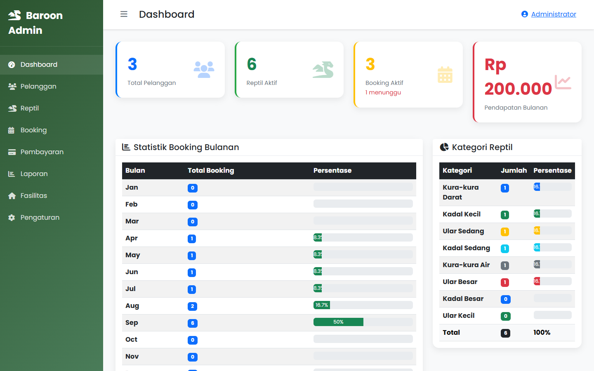
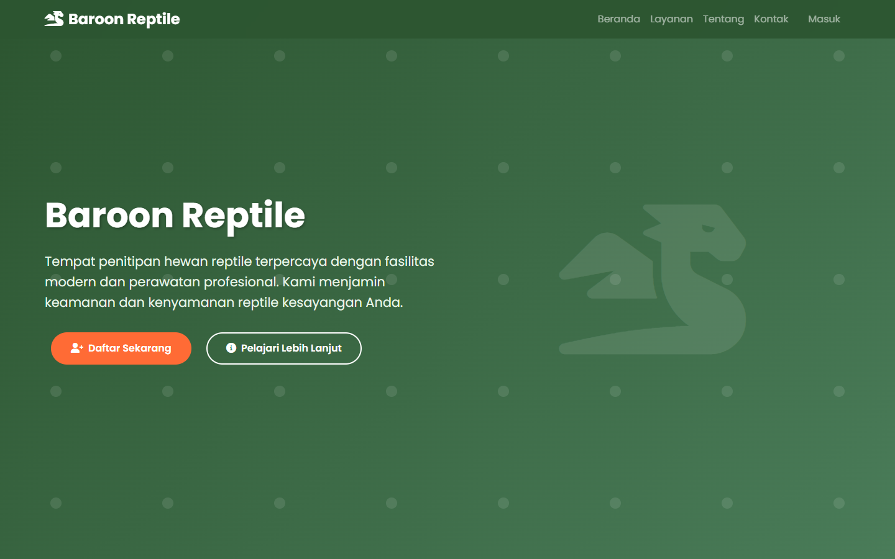
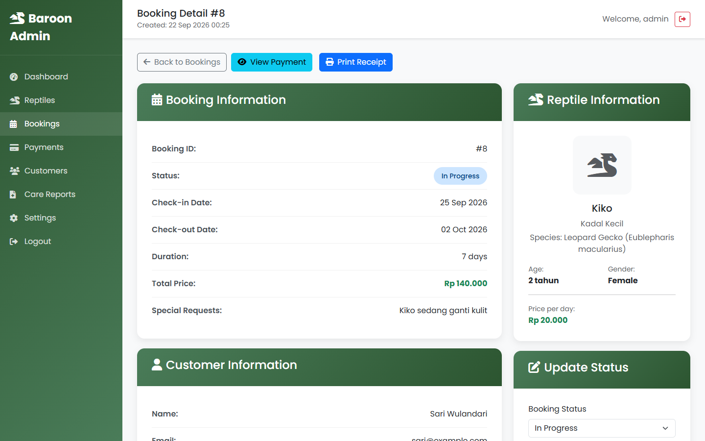
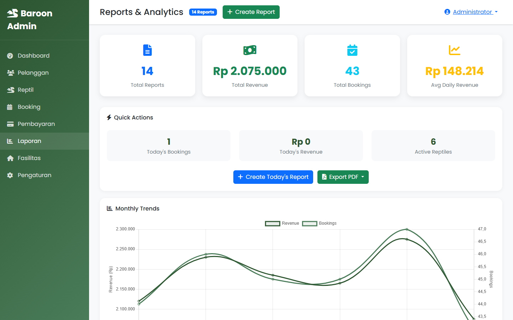
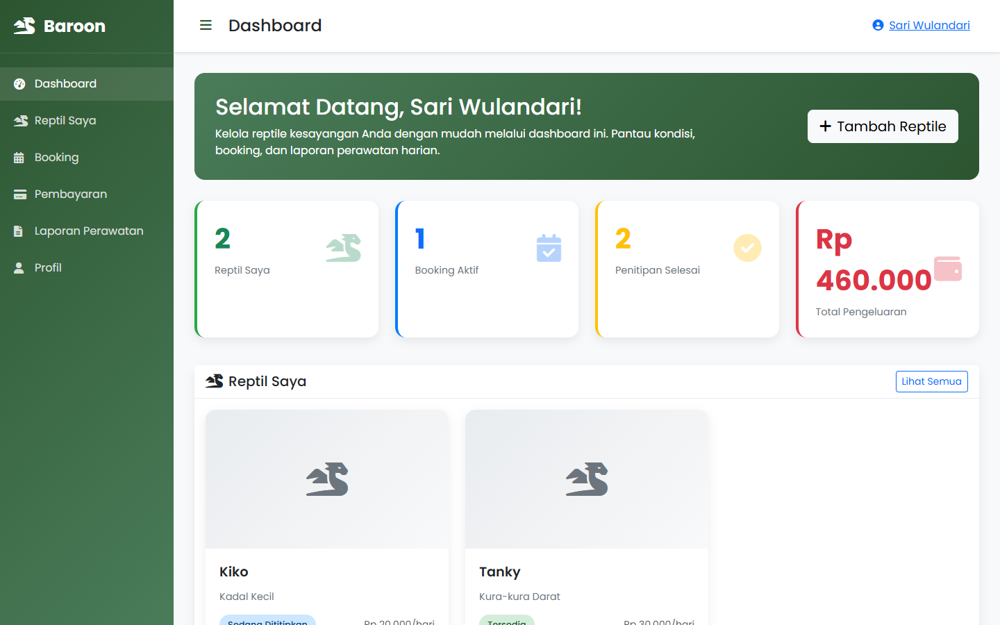
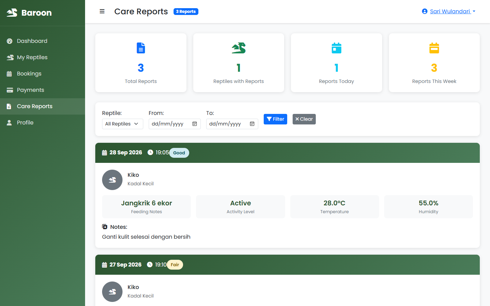
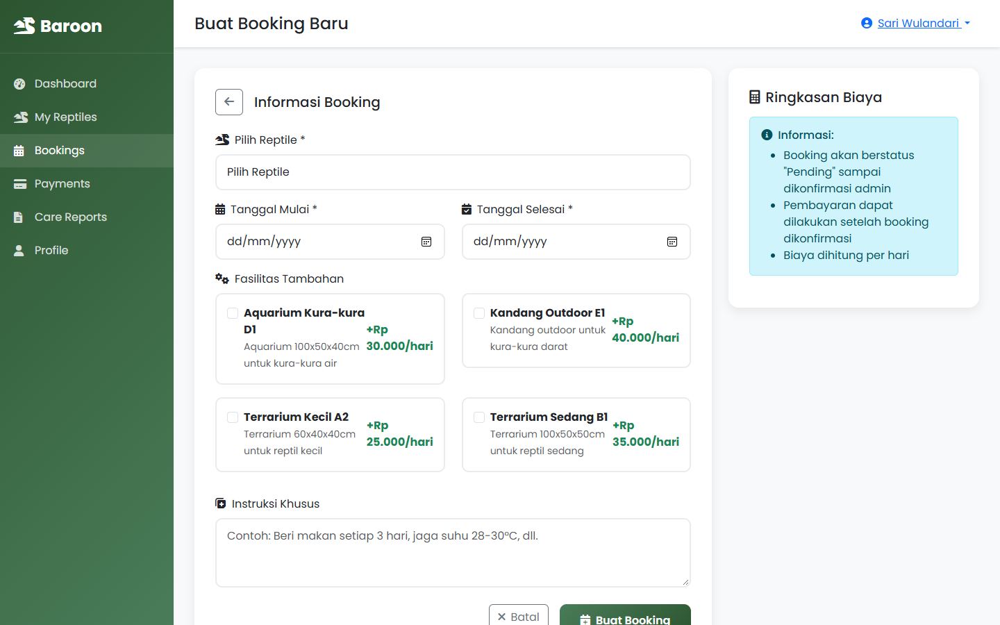
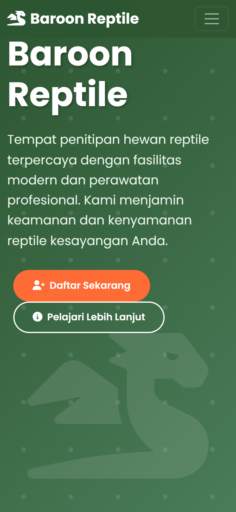

# 🦎 Baroon Reptile

Sistem informasi penitipan reptil berbasis web. Pemilik reptil bisa mendaftarkan hewannya, memesan penitipan, membayar, dan memantau laporan perawatan harian. Admin mengelola booking, pembayaran, fasilitas, dan laporan bisnis dari satu dashboard.




## Fitur

**Pelanggan**
- Registrasi dan login
- Kelola data reptil beserta foto
- Booking penitipan dengan perhitungan biaya otomatis per kategori reptil dan fasilitas tambahan
- Pembayaran (transfer, kartu kredit, e-wallet, tunai) dan riwayatnya
- Laporan perawatan harian: pemberian makan, kondisi kesehatan, suhu, dan kelembapan

**Admin**
- Dashboard statistik booking bulanan dan sebaran kategori reptil
- Kelola pelanggan, reptil, booking, dan status pembayaran
- Tulis laporan perawatan harian untuk reptil yang sedang dititipkan
- Kelola fasilitas penitipan (tersedia, terisi, maintenance)
- Laporan bisnis harian dengan grafik tren dan ekspor siap cetak
- Cetak kuitansi dan kirim pesan ke pelanggan

## Teknologi

| Lapisan | Teknologi |
|---|---|
| Backend | PHP 8 native dengan PDO (tanpa framework) |
| Database | MariaDB / MySQL |
| Frontend | Bootstrap 5.3, Chart.js, Font Awesome, Google Fonts (Poppins) |
| Server | Apache (XAMPP untuk lokal, Docker untuk server) |

## Menjalankan Aplikasi

### Opsi 1: Docker (disarankan)

Butuh [Docker](https://docs.docker.com/get-docker/) dengan Docker Compose.

```bash
git clone https://github.com/berryabdulghany/baroon-reptile.git
cd baroon-reptile
cp .env.example .env
```

Isi `DB_PASS` di file `.env` dengan password yang kuat, lalu jalankan:

```bash
docker compose up -d --build
```

Buka http://localhost:8080. Database beserta data demo dibuat otomatis saat pertama kali dijalankan.

### Opsi 2: XAMPP

1. Clone repo ini ke `C:\xampp\htdocs\baroon-reptile`.
2. Jalankan **Apache** dan **MySQL** dari XAMPP Control Panel.
3. Buat database `baroon_reptile` di phpMyAdmin, lalu import berurutan:
   1. `database/schema.sql`
   2. `database/seed.sql`
4. Buka http://localhost/baroon-reptile.

Konfigurasi bawaan sudah cocok dengan XAMPP (user `root`, tanpa password). Kalau berbeda, atur lewat environment variable di bawah.

### Akun Demo

| Peran | Username | Password |
|---|---|---|
| Admin | `admin` | `admin123` |
| Pelanggan | `customer1` | `customer123` |
| Pelanggan | `sari` | `customer123` |
| Pelanggan | `dimas` | `customer123` |

Semua data demo fiktif. Tanggalnya dihitung relatif terhadap hari import, jadi grafik dashboard selalu terisi.

## Konfigurasi

Semua konfigurasi dibaca dari environment variable (lihat [`config/database.php`](config/database.php)):

| Variabel | Default | Keterangan |
|---|---|---|
| `DB_HOST` | `localhost` | Host database |
| `DB_PORT` | `3306` | Port database |
| `DB_NAME` | `baroon_reptile` | Nama database |
| `DB_USER` | `root` | User database |
| `DB_PASS` | *(kosong)* | Password database |
| `APP_DEBUG` | `true` | `false` di server agar detail error tidak tampil ke pengunjung |

## Struktur Folder

```
├── admin/          Halaman admin
├── customer/       Halaman pelanggan
├── auth/           Login, registrasi, logout
├── config/         Konfigurasi dan bootstrap (database, session, CSRF)
├── includes/       Helper bersama: keamanan, upload foto, navbar
├── database/       schema.sql dan seed.sql
├── uploads/        Foto reptil yang diunggah pengguna
├── docker/         Konfigurasi Apache dan PHP untuk image Docker
└── docs/           SKPL, SPPL, user manual, dan screenshot
```

## Keamanan

- Password di-hash dengan bcrypt, semua query memakai prepared statement.
- Setiap form dilindungi token CSRF. Cookie session diset `HttpOnly` dan `SameSite=Lax`.
- Jenis file upload diperiksa dari isi file, bukan dari namanya. Nama file dibuat acak, dan folder upload tidak bisa menjalankan skrip.
- Output di-escape untuk mencegah XSS. Detail error hanya tampil saat `APP_DEBUG=true`.
- File sensitif (`.sql`, `.env`, `.md`, folder `config/` dan `includes/`) tidak bisa diakses langsung dari browser.

## Tangkapan Layar

| | |
|---|---|
|  **Beranda** |  **Detail booking (admin)** |
|  **Laporan bisnis (admin)** |  **Dashboard pelanggan** |
|  **Laporan perawatan (pelanggan)** |  **Buat booking (pelanggan)** |

<p align="center"><br><b>Tampilan mobile</b></p>

## Dokumentasi

- [Spesifikasi Kebutuhan Perangkat Lunak (SKPL)](docs/SKPL_Baroon_Reptile.md)
- [Spesifikasi Perancangan Perangkat Lunak (SPPL)](docs/SPPL_Baroon_Reptile.md)
- [User Manual](docs/User_Manual_Baroon_Reptile.md)
- [Changelog](CHANGELOG.md)

## Rencana Pengembangan

- Simpan fasilitas yang dipilih per booking (saat ini hanya ikut dihitung ke total harga)
- Seragamkan bahasa antarmuka (sebagian halaman masih berbahasa Inggris)
- Satukan sidebar yang masih disalin di tiap halaman menjadi satu template
- Halaman kelola kategori reptil dan testimoni pelanggan
- Notifikasi email dan integrasi payment gateway

